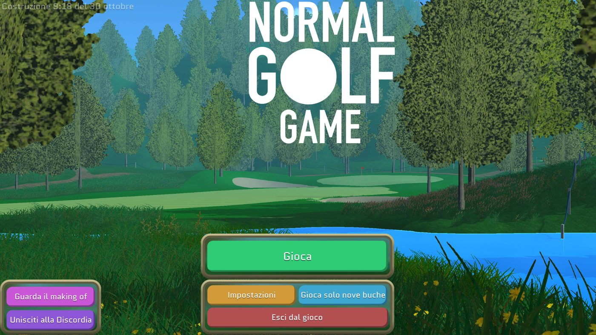
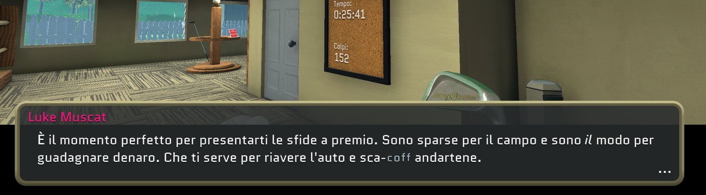
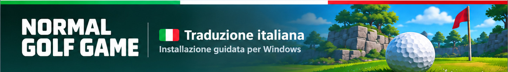

# 🇮🇹 Normal Golf Game — Traduzione italiana

**Traduzione italiana amatoriale, gratuita e non ufficiale** di **Normal Golf Game**, dedicata ai giocatori italiani.

La patch traduce dialoghi, menu, interfaccia e descrizioni delle sfide. Il doppiaggio rimane in inglese; termini golfistici come *par*, *green*, *draw*, *fade*, *hook* e *slice* vengono mantenuti quando appropriato.

> **Versione pubblica attuale: [Beta 0.9.1 — v0.9.1-beta](https://github.com/Trigger117/normal-golf-game-italian-translation/releases/tag/v0.9.1-beta).** Include il nuovo installer WPF e ulteriori traduzioni dei menu. È ancora una **beta**: alcuni testi potrebbero rimanere in inglese e i test su installazione pulita non sono completi.

## 📥 Download

**[Scarica la Beta 0.9.1 da GitHub Releases](https://github.com/Trigger117/normal-golf-game-italian-translation/releases/tag/v0.9.1-beta)**

La release contiene due file:

- **[NormalGolf_Installer_WPF.exe](https://github.com/Trigger117/normal-golf-game-italian-translation/releases/download/v0.9.1-beta/NormalGolf_Installer_WPF.exe)** — installer automatico Windows (consigliato).
- **[NormalGolf_Italian_v0.9.1.zip](https://github.com/Trigger117/normal-golf-game-italian-translation/releases/download/v0.9.1-beta/NormalGolf_Italian_v0.9.1.zip)** — installazione manuale.

### 🖥️ Installazione automatica (Windows)

1. Chiudi Normal Golf Game.
2. Avvia `NormalGolf_Installer_WPF.exe`.
3. Seleziona la cartella che contiene `Normal Golf Game.exe`.
4. Mantieni selezionata l'opzione per installare BepInEx e XUnity se non sono già presenti (richiede Internet).
5. Premi **Installa la traduzione**. Al completamento avvia il gioco in **English**.

L'installer crea backup dei file sovrascritti. È stato provato su Windows con le dipendenze già presenti; **il download automatico delle dipendenze su un'installazione pulita deve ancora essere verificato**.

## 🛠️ Installazione manuale

1. Chiudi il gioco.
2. Installa [BepInEx 5 per Unity Mono](https://github.com/BepInEx/BepInEx/releases) e [XUnity.AutoTranslator per BepInEx](https://github.com/bbepis/XUnity.AutoTranslator/releases).
3. Scarica **NormalGolf_Italian_v0.9.1.zip** e decomprimilo nella cartella che contiene `Normal Golf Game.exe`.
4. Nel file di configurazione XUnity (sotto `BepInEx/config`) imposta:

   ```ini
   Language=it
   FromLanguage=en
   Endpoint=
   FallbackEndpoint=
   ```

5. Avvia Normal Golf Game lasciando **English** come lingua originale.

Se la configurazione di XUnity non è ancora stata generata, avvia il gioco una volta dopo aver installato il plugin. Se avevi traduzioni automatiche precedenti, segui il `LEGGIMI.txt` nello ZIP per evitare interferenze con vecchie cache.

## 🎮 Contenuto e limiti

- **881 voci I2 Localization** verificate come applicate nei log durante test.
- **358 regole** per le descrizioni delle sfide.
- Almeno una sfida verificata in gioco: **«Isola minuscola 1»**.
- Le verifiche non coprono ancora tutte le schermate, le sfide e i dialoghi. La numerazione interna del plugin **1.5** è distinta dalla release pubblica **0.9**.

## 📷 Anteprima della traduzione

Schermate reali di una build di test della traduzione italiana. Sono indicative: la Beta 0.9.1 può presentare differenze e alcune voci restano da perfezionare.

**Menu principale tradotto**



**Esempio di dialogo italiano**



**Grafica dell'installer WPF**



## 💻 Sorgenti e contributi

Il progetto è organizzato in:

- [Plugin C# per BepInEx](plugin/README.md) — codice sorgente, istruzioni e compilazione locale.
- [Dizionari italiani](translations/README.md) — traduzioni I2, sfide e dizionario offline XUnity.
- [Installer WPF](installer/README.md) — interfaccia XAML, PowerShell, launcher C++ e compilazione.
- [Procedura di release](docs/RELEASE_PROCESS.md) — test richiesti prima della pubblicazione.

Il **codice originale** del progetto è distribuito sotto [licenza MIT](LICENSE). I **testi del gioco e i dizionari derivati** sono esclusi dalla licenza MIT: vedi [Licenze e diritti](LICENSING.md).

## 🐛 Segnalazioni

Se trovi testi in inglese, errori di traduzione o problemi tecnici, apri una [segnalazione su GitHub](https://github.com/Trigger117/normal-golf-game-italian-translation/issues) con screenshot, versione e contesto. Se alleghi log, oscura percorsi personali e altri dati privati.

- [Cronologia modifiche](CHANGELOG.md)
- [Problemi noti](docs/KNOWN_ISSUES.md)
- [Test e verifiche](docs/TESTING.md)

## ⚖️ Avvertenze

Traduzione **amatoriale, gratuita e non ufficiale**. Non è affiliata, approvata o supportata da Luke Muscat o dagli altri titolari dei diritti di Normal Golf Game. La patch richiede una copia legittima del gioco e non include eseguibili o asset originali del videogioco.
